# GenPic

**Un SaaS de retratos con IA terminado, probado y en producción, que se libera
después de fracasar comercialmente.** Laravel 11 · Livewire 3 · Filament 3 ·
Stripe · fal.ai.

[Read in English](README.md)


## Qué era y qué pasó

GenPic convertía una foto tuya, de tu familia o de tus amigos en un retrato
pintado: óleo renacentista, ukiyo-e, anime, estudio de los años veinte, foto
para LinkedIn… 73 estilos en nueve categorías. Subías la foto, elegías estilo,
veías en menos de un minuto una vista previa con marca de agua y pagabas solo
si querías el archivo limpio.

Estuvo en genpic.com de marzo a octubre de 2026, en cinco idiomas y con pagos
reales por Stripe, IVA europeo incluido. Se generaron muchísimas vistas previas
gratis y **nadie compró ninguna**: cero ventas. En septiembre de 2026 se
cerraron las altas y los pagos, y en octubre se dio de baja el dominio.

El código, en cambio, estaba acabado, tenía tests y funcionaba en producción,
así que tirarlo nos parecía un desperdicio. Aquí lo tienes con licencia MIT. Si
estás montando algo con generación de imágenes por IA, descargas de pago o una
web Laravel en varios idiomas, seguramente encuentres algo que aprovechar.

## Capturas

<table>
  <tr>
    <td width="50%">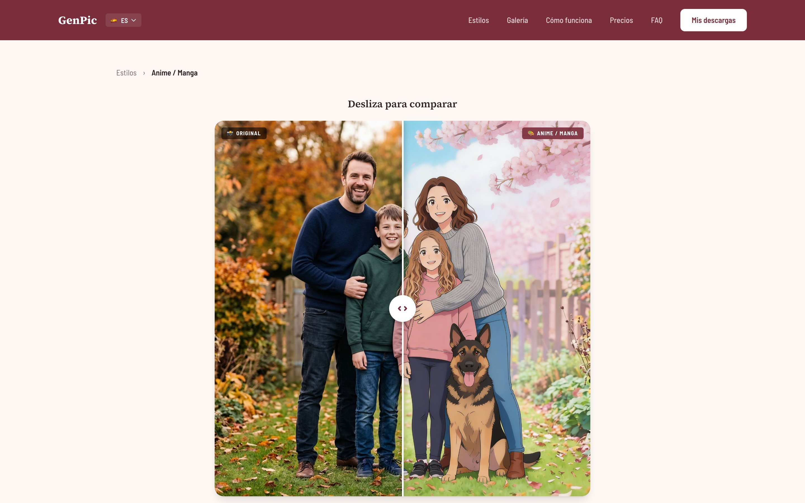</td>
    <td width="50%">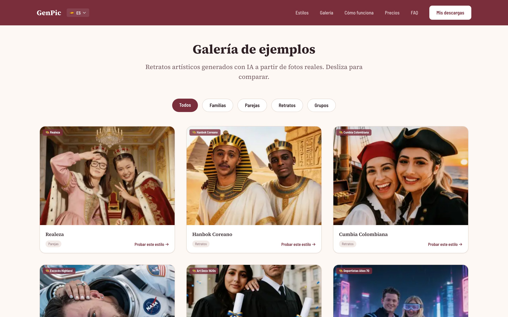</td>
  </tr>
  <tr>
    <td><b>Ficha de estilo</b>: arrastras para comparar la foto con el retrato</td>
    <td><b>Galería</b> con 36 pares antes/después</td>
  </tr>
  <tr>
    <td>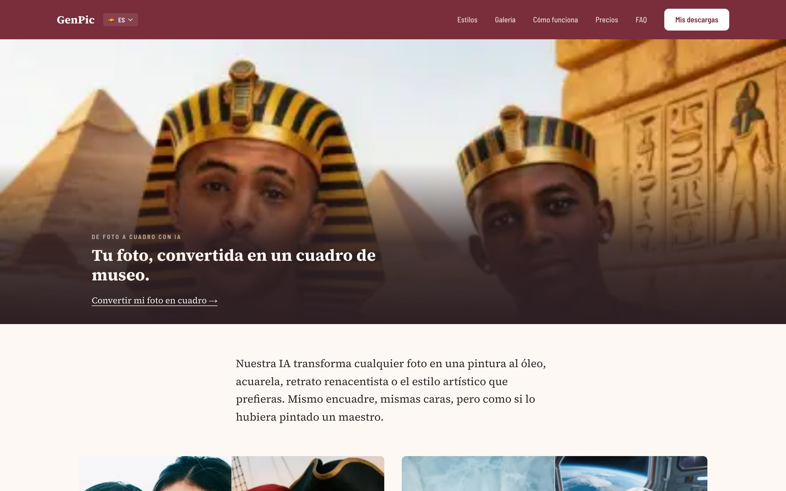</td>
    <td></td>
  </tr>
  <tr>
    <td><b>Landings</b>: diez, cada una con su propia estructura</td>
    <td><b>Admin</b>: ingresos, conversión y coste de IA (los ceros son reales)</td>
  </tr>
  <tr>
    <td></td>
    <td></td>
  </tr>
  <tr>
    <td><b>Proveedores IA</b>: cadena de respaldo, cooldowns y coste por imagen</td>
    <td><b>Estilos</b>: textos traducidos y el prompt que hay detrás de cada uno</td>
  </tr>
</table>

<table>
  <tr>
    <td width="25%">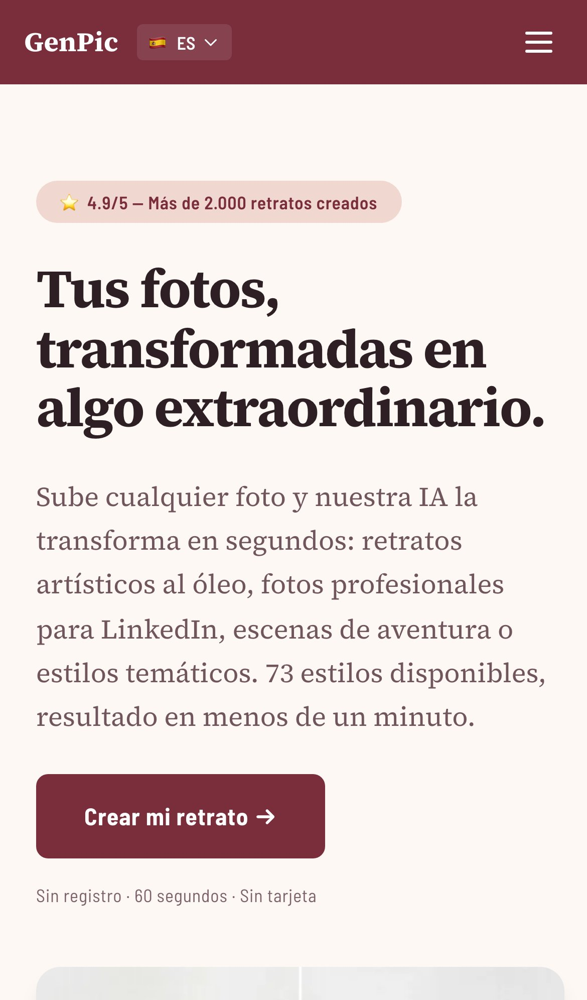</td>
    <td width="25%">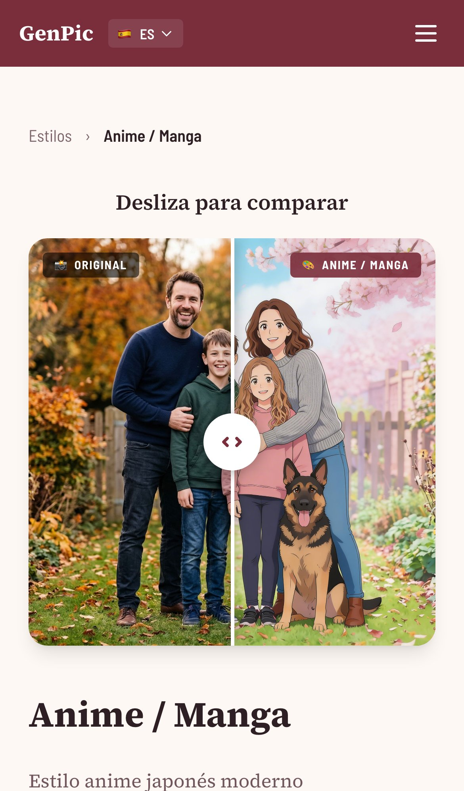</td>
    <td width="50%"><b>Móvil</b>: portada y ficha de estilo en un teléfono.</td>
  </tr>
</table>

<details>
<summary>Más capturas</summary>

| | |
|---|---|
| 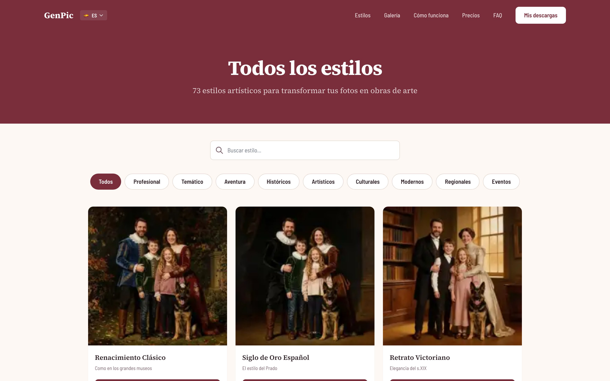 | 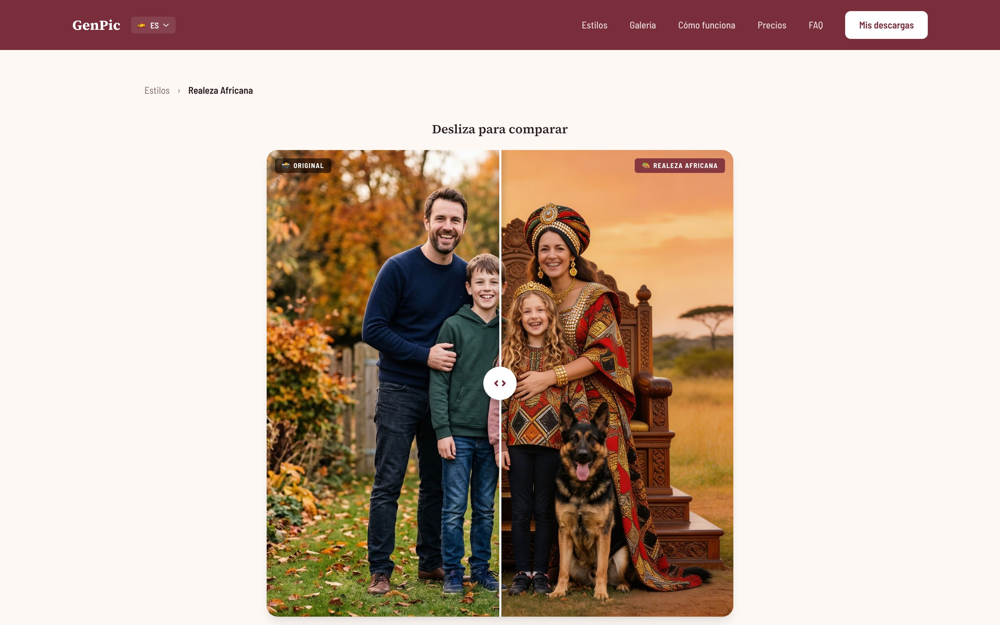 |
| Catálogo de estilos con filtro por categoría | Otra ficha de estilo |
|  |  |
| Subida de la foto | Detección facial en el navegador, antes de enviar nada |
| 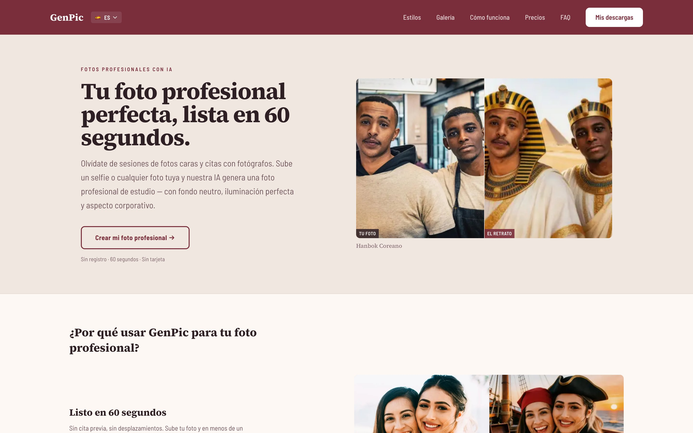 | 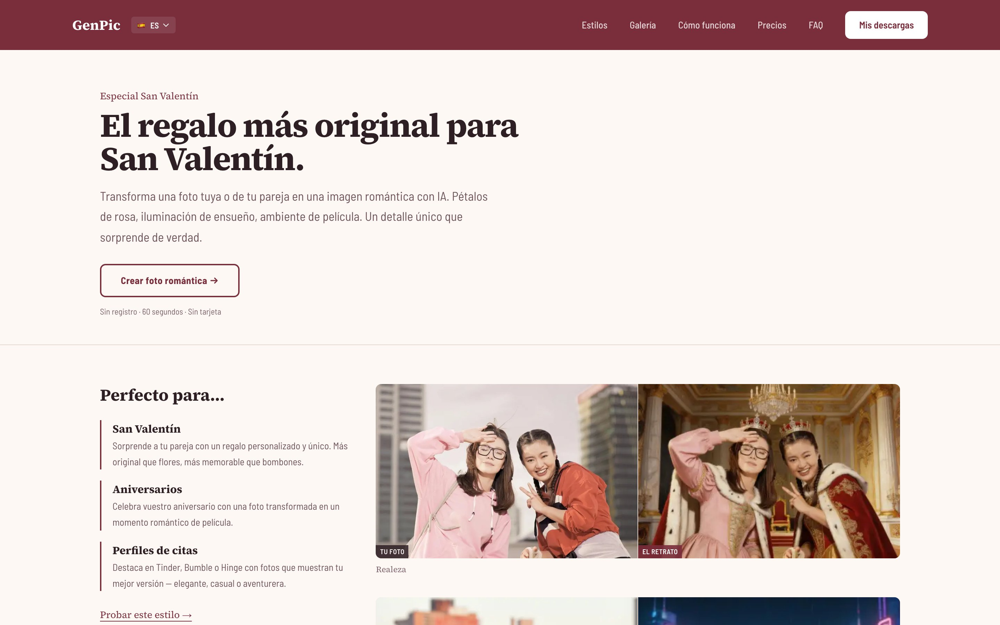 |
| Landing de fotos profesionales | Landing de San Valentín |
|  |  |
| Inglés | Francés |
| 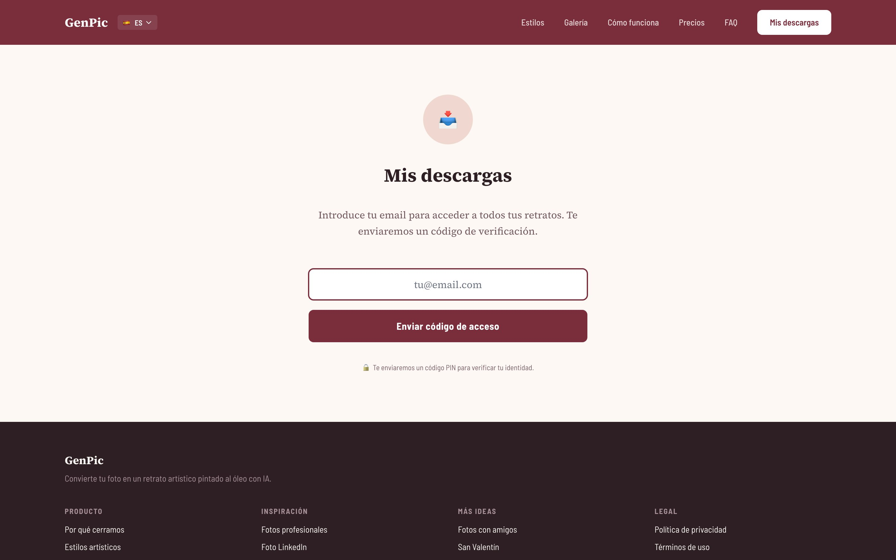 |  |
| Recuperar retratos anteriores con el email | Página 404 |
|  |  |
| Modo cierre, la despedida de la web | `/create` respondiendo 410 en modo cierre |
|  |  |
| Admin: estilos | Admin: una línea por cada llamada a la IA, con su coste |
|  |  |
| Admin: ejemplos de galería | Admin: productos |
| 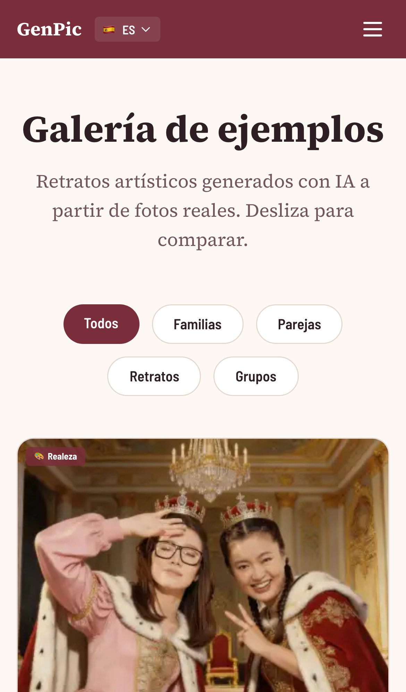 | 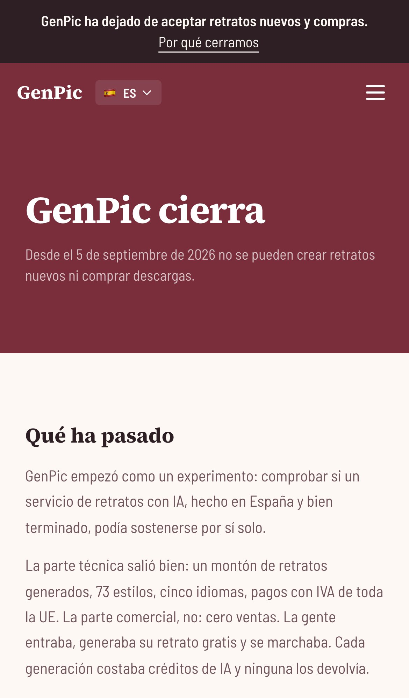 |
| Galería en el móvil | Página de cierre en el móvil |

Capturas de página completa: [portada](docs/screenshots/02-home-full.jpg) y
[landing de fotos de familia](docs/screenshots/11-landing-family-full.jpg).

</details>

## Qué hay dentro que merezca la pena

- **El embudo completo**: subida → detección facial → moderación → job de IA
  → polling → vista previa con marca de agua → captura de email → Stripe
  Checkout → entrega por URL firmada → purga automática de ficheros.
- **IA con varios proveedores y respaldo.** fal.ai, OpenRouter, Novita y
  Evolink detrás de una misma interfaz, con cooldown por proveedor, un
  presupuesto diario que reordena la cadena poniendo primero el más barato y
  el coste de cada llamada registrado.
- **Stripe bien hecho**: Checkout con Stripe Tax para el IVA europeo (OSS),
  webhooks idempotentes con firma verificada y un comando que cada cinco
  minutos recupera los pagos cuyo webhook no llegó.
- **Moderación que no cuesta nada por imagen**: un clasificador NSFW de
  Hugging Face revisa la foto antes de cualquier generación de pago, y los
  bans de IP van en Redis con respaldo en base de datos.
- **Cinco idiomas con slugs traducidos** (`/fotos-de-familia`,
  `/en/family-photos`, `/fr/photos-de-famille`…) y `hreflang` correcto, que es
  justo lo que casi nadie hace bien.
- **Admin con Filament**: nueve widgets de métricas, visor privado de
  imágenes, anonimización RGPD, campañas de email con baja y una página de
  salud del sistema.
- **Un sistema de diseño escrito** ([docs/design.md](docs/design.md)) aplicado a
  diez landings, cada una con una estructura distinta.
- **Privacidad de serie**: fuentes autoalojadas, sin cuentas ni contraseñas
  para quien compra, URL firmadas para todos los ficheros y la foto original
  nunca vuelve al navegador.
- **178 tests** sobre SQLite en memoria, que la CI pasa en cada push.

## Arranque rápido

```bash
git clone https://github.com/dcarrero/genpic.git
cd genpic
cp .env.example .env
docker compose up -d --build        # la primera vez: dependencias, assets, migraciones y siembra
docker compose exec app php artisan key:generate
```

Abre http://localhost:8101. Los emails llegan a Mailpit, en
http://localhost:8025.

Con eso tienes la web entera, con sus 73 estilos y la galería. Para entrar en
el admin, generar retratos o probar el pago sin Stripe, sigue
**[docs/INSTALL-ES.md](docs/INSTALL-ES.md)**, donde también se explica cómo
instalarlo sin Docker, cómo pasar los tests y qué hacer con los problemas
habituales.

## Servicios externos y lo que cuestan

| Servicio | Para qué | Coste |
|----------|----------|-------|
| [fal.ai](https://fal.ai) | Generación principal (SeedReam) y reescalado | ≈ 0,035 $ por imagen |
| [OpenRouter](https://openrouter.ai) | Generación de respaldo | ≈ 0,04 $ por imagen |
| Novita, Evolink | Respaldos opcionales (desactivados por defecto) | ≈ 0,03 $ por imagen |
| [Hugging Face](https://huggingface.co) | Moderación NSFW | Bastó con el plan gratuito |
| [Stripe](https://stripe.com) | Pagos e IVA europeo con Stripe Tax | Comisiones estándar más Stripe Tax |
| Almacenamiento compatible con S3 | Fotos e imágenes generadas | Céntimos a esta escala (en producción, Wasabi) |
| SMTP | Email transaccional | El proveedor que quieras |
| Redis + MariaDB | Colas, caché y datos | Tu propio servidor |

Las cifras por imagen son las estimaciones de `config/image_providers.php`, las
que usa el presupuesto diario. Comprueba los precios actuales antes de fiarte.

## Antes de abrirlo al público

- [ ] **Reescribe los textos legales.** Las claves `legal_*` de
      `lang/*/ui.php` tienen la política de privacidad, las condiciones, la
      política de cookies y el aviso legal pensados para una empresa española,
      ahora con datos de ejemplo. Son un punto de partida y no un
      asesoramiento jurídico.
- [ ] Configura `APP_URL`, `COMPANY_NAME` y `CONTACT_EMAIL`.
- [ ] Configura `ADMIN_EMAILS` y `ADMIN_ALLOWED_IPS`. Cambiar `ADMIN_PATH` solo
      esconde el panel; lo que lo protege es la lista de IP.
- [ ] Tus claves de Stripe y el secreto del webhook, con Stripe Tax activado.
      Con `STRIPE_SECRET` vacío el pago se simula, y en producción eso
      significa pedidos gratis.
- [ ] Al menos un proveedor de IA con saldo y un `DAILY_COST_BUDGET_USD`
      razonable (reordena los proveedores, no los para).
- [ ] Un bucket privado. La app nunca hace públicos los objetos.
- [ ] Tus precios, en `database/seeders/FormatsAndProductsSeeder.php` y en las
      claves `pricing_price_*` de `lang/*/ui.php`.
- [ ] Revisa los prompts de los estilos contra la política de contenidos de tu
      proveedor ([docs/ARTISTIC_PROMPTS.md](docs/ARTISTIC_PROMPTS.md)).
- [ ] Deja `CLOSED_MODE=false`, que es el valor por defecto.

El despliegue en producción (releases atómicas, cron y Horizon) está en
[docs/DEPLOY.md](docs/DEPLOY.md).

## Documentación

Está todo en **[docs/README.md](docs/README.md)**: instalación, configuración,
despliegue, personalización (estilos, idiomas, proveedores de IA, precios y
textos legales), arquitectura y convenciones de código. Salvo la guía de
instalación, que tienes en español en
[docs/INSTALL-ES.md](docs/INSTALL-ES.md), esos documentos están en inglés.

Los comentarios del código y algunos documentos de contexto están en
castellano, porque el proyecto se hizo primero para el mercado español.

## Estado

El servicio está cerrado y no hay hoja de ruta. Puedes abrir issues y pull
requests, pero no hay compromiso de mantenimiento. Mira
[CONTRIBUTING.md](CONTRIBUTING.md) y [SECURITY.md](SECURITY.md).

## Licencia

[MIT](LICENSE) © 2026 Color Vivo Internet S.L.

Las fotos «antes» de la galería son de Unsplash, con la Unsplash License
([créditos](public/img/gallery/CREDITS.md)). Las fuentes de `public/fonts/`
tienen licencia SIL Open Font License 1.1.
